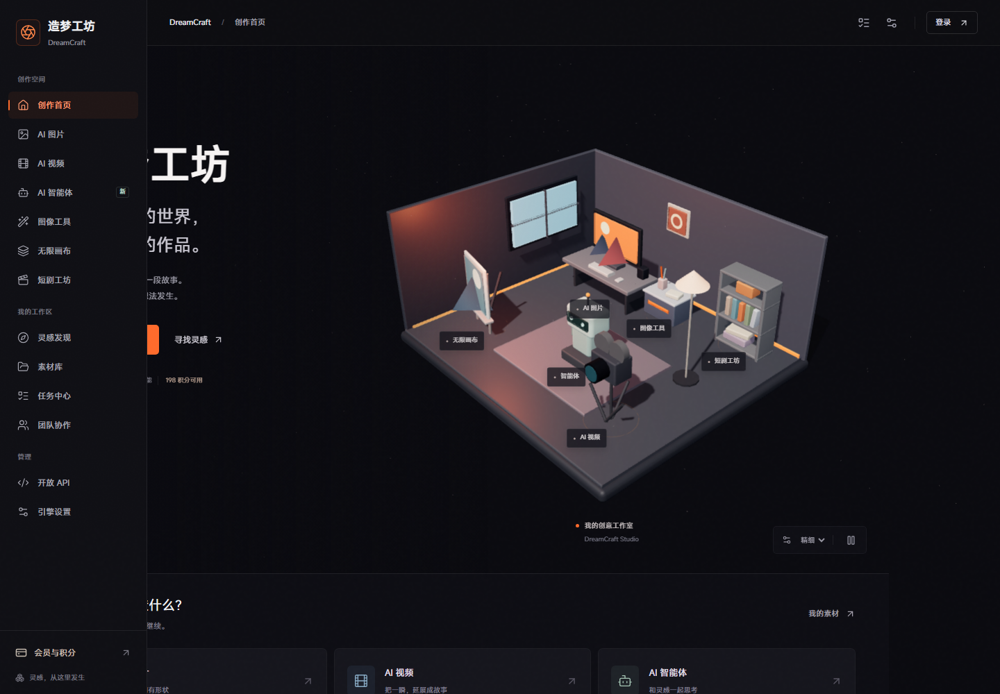

# 造梦工坊 DreamCraft

面向个人创作者的图像、视频与素材工作区。连接自己的 ComfyUI 或云端 API，在 Windows 桌面版中创作，也可自部署为网页应用。

[下载 1.3.0](https://github.com/kein02/webpage-and-app/releases/tag/dreamcraft-v1.3.0) · [版本说明](docs/releases/1.3.0.md) · [API 接入](docs/api-setup.md) · [ComfyUI 部署](docs/comfyui-setup.md) · [网页部署](docs/deployment.md)



## 下载与开始使用

| 方式 | 下载或入口 | 要求 |
|---|---|---|
| Windows 安装版 | [DreamCraft-Setup-1.3.0-x64.exe](https://github.com/kein02/webpage-and-app/releases/download/dreamcraft-v1.3.0/DreamCraft-Setup-1.3.0-x64.exe) | Windows 10/11 x64，无需 Python、Node.js |
| Windows 便携版 | [DreamCraft-Windows-1.3.0-x64.zip](https://github.com/kein02/webpage-and-app/releases/download/dreamcraft-v1.3.0/DreamCraft-Windows-1.3.0-x64.zip) | 完整解压，运行 `DreamCraft/DreamCraft.exe`，保留 `_internal` |
| 网页自部署 | [Docker / 源码部署指南](docs/deployment.md) | 持久化存储、自己的 ComfyUI 或云端 API |

1. 安装或解压后打开 DreamCraft，等待浏览器自动打开工作区。
2. 注册并登录，在「引擎设置」连接自己的 ComfyUI，或填写云端 API Key，测试并保存。
3. 在「AI 图片」生成一张图片，确认能在素材库预览；在任务中心查看进度或错误。

程序不包含 ComfyUI、模型、公共算力或作者密钥。本机 ComfyUI 需要先启动；视频生成需要云端 API，短剧合成另需 FFmpeg。首次使用引导可跳过，也可在引擎设置中重新打开。

关闭启动窗口会停止服务，关闭浏览器标签页不会停止。安装和依赖排障见 [Windows 使用](docs/windows.md)。

## 1.3.0：选择全部数据的保存位置

在启动窗口点击「迁移数据文件夹」，选择一个空文件夹。先保存项目并等待生成结束，程序会停止服务、迁移并校验账号、项目、配置、密钥、上传素材、生成文件和日志，成功后移除旧数据并从新目录重启。**后续应用数据只写入所选目录，不自动另存第二份。**

本机模式新生成的云端图片、视频会下载到当前数据目录的 `exports`；既有远程素材不会自动补下载。新目录所在磁盘不可访问时会提示错误，不会回退建立空白数据库。

ComfyUI、模型、浏览器配置、未保存草稿及浏览器手动下载目录独立管理。迁移范围与失败处理见 [数据目录说明](docs/windows.md#备份与恢复)，历史变化见 [版本说明](docs/releases)。

## 创作功能

| 工作流 | 内容 |
|---|---|
| 图像 | 文生图、参考图生成、局部重绘、扩图、透明抠图、换背景、ComfyUI 模型 AI 放大与普通插值 |
| 视频与短剧 | 云端视频任务、逐镜头编辑与排序、字幕、裁剪、配乐和 FFmpeg 成片合成 |
| 项目与画布 | 项目自动保存、打开、重命名；画布撤销与重做 |
| 素材与任务 | 搜索、名称与标签、回收站恢复、所选本机素材 ZIP 下载、任务详情、失败重试与查询恢复 |
| 桌面数据 | 完整目录迁移、全量备份、校验恢复与恢复前自动备份 |

图片支持本机 ComfyUI 或 Agnes；视频适配 Agnes、硅基流动、百炼、智谱与火山方舟。模型、权限、额度和排队状态由供应商决定，重试生成可能再次计费。真实付费云端视频与完整短剧生成链路尚未完成验收，范围见 [生成验收](docs/generation-acceptance.md)。真实支付未接入，充值和付费订阅默认关闭。

## 数据、备份与更新

| 运行方式 | 数据目录 |
|---|---|
| Windows 应用 | 初始 `%LOCALAPPDATA%\DreamCraft`；迁移后使用所选目录 |
| 源码本机模式 | 默认 `app/backend`，可用 `--data-dir` 指定 |
| 源码公开模式 | 默认 `app/backend/public-data`，可用 `--data-dir` 指定 |
| Docker Compose | 持久化命名卷，容器内 `/data` |

启动器提供「打开数据目录」「备份数据」「恢复备份」。备份 ZIP 包含账号、作品及文件形式的密钥，未额外加密，请保存在私人位置。手动备份前停止服务，复制整个数据目录，不能只复制正在写入的 SQLite 主文件。

1.1.0 起可在启动器检查、下载并确认更新；1.0.x 需要手动安装新版一次。升级前保存项目并备份数据，卸载保留个人数据。当前包未签名，签名与更新机制见 [Windows 更新](docs/desktop-updates.md)。在 [Release](https://github.com/kein02/webpage-and-app/releases/tag/dreamcraft-v1.3.0) 下载 `SHA256SUMS.txt` 后，可用 PowerShell 核对安装器：

```powershell
Get-FileHash .\DreamCraft-Setup-1.3.0-x64.exe -Algorithm SHA256
```

输出的 SHA256 应与校验文件中同名条目一致。

## 自部署与开发

已有源码时，在 `DreamCraft` 目录运行 `docker compose up -d --build`，打开 `http://127.0.0.1:8100`。完整克隆、持久卷、HTTPS、备份及 Railway/Vercel 步骤见 [部署指南](docs/deployment.md)。

源码开发需要 Python 3.11+、Node.js 20.19+ 或 22.12+：

```powershell
git clone https://github.com/kein02/webpage-and-app.git
cd webpage-and-app/DreamCraft
python -m pip install -r app/backend/requirements.txt
npm ci --prefix app/frontend
npm run build --prefix app/frontend
python serve.py --mode local --port 8102
```

浏览器打开 `http://127.0.0.1:8102`。`local` 使用当前电脑的默认引擎与 API 环境变量；公开部署用 `--mode public` 和独立数据目录，公开模式忽略站长密钥，要求用户登录并配置自己的引擎。开发热更新使用 `python run.py`，停止用 `python stop.py`，默认保留外部 ComfyUI。

后端为 FastAPI/SQLite，前端为 React/Vite/Three.js，当前后端限一个 worker。测试和维护约定见 [参与开发](CONTRIBUTING.md)，桌面构建与自动发布见 [Windows 构建](docs/windows.md#构建)。

> [!IMPORTANT]
> 此目录是 React/FastAPI 版 DreamCraft。仓库中的 DreamForge 是独立 Node.js 项目，两者的安装包、数据和配置不能混用。GitHub Pages 无法运行本项目的完整后端。

## 文档与排障

| 入口 | 适用问题 |
|---|---|
| [Windows 使用与构建](docs/windows.md) | 安装、便携版、数据迁移、备份恢复、卸载 |
| [API 接入](docs/api-setup.md) | 图片/视频密钥、模型、调用和接口错误 |
| [ComfyUI 部署](docs/comfyui-setup.md) | 地址、模型、节点、跨域与显存问题 |
| [工作区使用](docs/workspace.md) | 项目保存、素材管理、短剧编辑与任务恢复 |
| [网页部署](docs/deployment.md) | Docker、源码、HTTPS、模式隔离与备份 |
| [Windows 验收](docs/windows-acceptance.md) / [生成验收](docs/generation-acceptance.md) | 已验证范围、复测命令与未验证项 |

## 参与贡献

欢迎通过本仓库 Issues/PR 提交问题和改进，请注明 DreamCraft、版本、系统及复现步骤。环境与回归命令见 [贡献说明](CONTRIBUTING.md)。请勿上传 `.env`、数据库、密钥、私人作品或包含令牌的链接。

## License

沿用所在仓库的 [Apache-2.0](LICENSE) 许可。第三方依赖、ComfyUI、自定义节点和模型遵循各自许可；模型与供应商服务授权由使用者自行确认。
