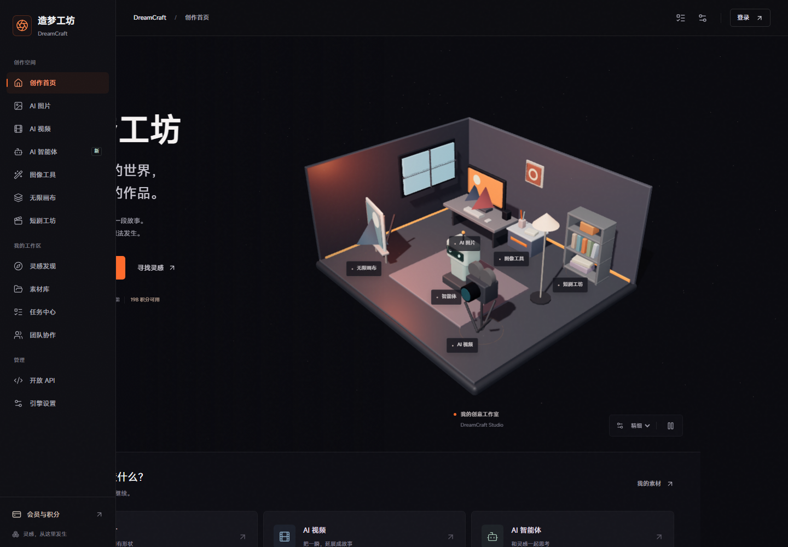

# 造梦工坊 DreamCraft

面向个人创作者的图像、视频与素材工作区，支持 Windows 安装版和网页自部署，接入自己的 ComfyUI 或云端 API。

[Windows 下载](https://github.com/kein02/webpage-and-app/releases/tag/dreamcraft-v1.0.0) · [API 接入](docs/api-setup.md) · [ComfyUI 部署](docs/comfyui-setup.md) · [网页部署](docs/deployment.md)



## 快速开始

| 方式 | 下载或运行 | 要求 |
|---|---|---|
| Windows 安装版 | [DreamCraft-Setup-1.0.0-x64.exe](https://github.com/kein02/webpage-and-app/releases/download/dreamcraft-v1.0.0/DreamCraft-Setup-1.0.0-x64.exe) | Windows 10/11 x64，无需 Python/Node |
| Windows 便携版 | [DreamCraft-Windows-1.0.0-x64.zip](https://github.com/kein02/webpage-and-app/releases/download/dreamcraft-v1.0.0/DreamCraft-Windows-1.0.0-x64.zip) | 解压后运行 DreamCraft.exe，保留 `_internal` |
| 网页自部署 | `docker compose up -d --build` | 在本目录执行，需要 Docker/Compose |

Windows 首次启动后注册登录，进入「引擎设置」，连接自己的 ComfyUI 或填 API Key，再生成一张低分辨率图片验证。程序不包含模型、公共算力或作者的密钥。安装包带中文向导、桌面快捷方式、图标和版本号；卸载保留个人数据。当前无自动更新和数字签名。

Docker 克隆与验证命令见 [部署指南](docs/deployment.md)。版本更新前备份数据，Windows 下载新版安装包或替换便携文件，Docker 更新源码后重新构建。校验文件位于同一 Release，PowerShell 可用 `Get-FileHash .\DreamCraft-Setup-1.0.0-x64.exe -Algorithm SHA256` 核对。

> [!IMPORTANT]
> 本目录是 React/FastAPI 版 DreamCraft。仓库中的 DreamForge 是独立的 Node.js 项目，两者的安装包、数据和配置不能混用。GitHub Pages 无法运行本项目的完整后端。

## 目录

| 位置 | 内容 |
|---|---|
| `app/frontend` | React、Vite、Three.js 界面 |
| `app/backend` | FastAPI、SQLite、引擎及视频平台适配 |
| `desktop` | Windows 启动器、图标、版本资源与安装包构建 |
| `tests` | 离线回归、浏览器验收和可选 GPU 实测 |
| `releases` | 可分发安装包、便携 ZIP 与已解压应用；不提交 Git |
| `docs` | 部署、Windows 使用、验收记录与整理清单 |
| `local-data` | 本机公开模式预览数据；不提交 Git |
| `build`、`tools` | 可再生成的构建目录与本机构建工具；不提交 Git |

前端为 React/Vite/Three.js，后端为 FastAPI/SQLite。模型在独立 ComfyUI 或供应商平台运行。

## Windows 使用

打开 `releases` 中的安装程序，或解压便携 ZIP 后运行 `DreamCraft.exe`。程序启动本机网页并打开浏览器，关闭启动窗口停止服务。无需 Python 或 Node.js。

ComfyUI、模型和云端密钥由使用者提供。短剧视频合成另需 FFmpeg。详细说明见 [Windows 使用与构建](docs/windows.md)。

## 源码运行

Python 3.11+、Node.js 20.19+ 或 22.12+，图像生成另需 ComfyUI 或云端密钥。建议虚拟环境，完整步骤见部署指南。

```powershell
git clone https://github.com/kein02/webpage-and-app.git
cd webpage-and-app/DreamCraft
python -m pip install -r app/backend/requirements.txt
cd app/frontend
npm ci
npm run build
cd ../..

# 本机：使用运行电脑上的默认引擎与 API 环境变量
python serve.py --mode local --port 8102

# 公开：用户登录并配置自己的引擎，忽略站长 API
python serve.py --mode public --port 8103
```

开发热更新使用 `python run.py`，前端 5173、后端 8100。该脚本可以复用已启动的 ComfyUI Desktop。`stop.py --app` 停止开发端口；不要用无参数的 `stop.py` 停掉正在使用的 ComfyUI。

## 功能与边界

- 图像：文字生成、参考图生成、局部重绘、扩图、透明抠图、换背景。模型及节点须安装齐全；高清化当前为 Lanczos 插值。
- 视频：Agnes、硅基流动、百炼、智谱、火山方舟适配，任务进度、失败提示与素材保存。付费云端协议通过模拟响应测试，真实结果取决于平台、余额与队列。
- 工作区：画布、素材、任务、短剧合成、团队和账号。真实支付未接入，充值及付费订阅默认关闭。
- 本机引擎优先使用当前电脑的 ComfyUI；公开模式没有默认算力，也不能代理访问站长的本机引擎。
- 浏览器出图配置按账号保存；后端引擎密钥 Fernet 加密、不回显。公开文件按素材所属账号鉴权。
- 当前后端只运行一个 worker；后台运行中的任务遇到重启会失败并退款，已完成任务和作品记录保留。

## 数据与备份

| 模式 | 默认位置 |
|---|---|
| 源码本机模式 | `app/backend` |
| 源码公开模式 | `app/backend/public-data`，可用 `--data-dir` 指定 |
| Windows 应用 | `%LOCALAPPDATA%\DreamCraft` |

数据库、`uploads`、`exports`、`.jwt-secret`、`.engine-key` 和 `.env` 都是私人运行数据，不得放进 GitHub 或交付包。停止服务后备份整个数据目录；不能只复制正在写入的 SQLite 主文件。

## 验证

```powershell
python tests/test_backend.py
python tests/test_public_security.py
python tests/test_modes.py local
python tests/test_modes.py public
python tests/test_release_browser.py
```

浏览器测试需要 Playwright。GPU 实测由 `test_local.py`、`test_direct.py` 等脚本单独执行，会调用本机 ComfyUI。测试输出在 `tests/output`，历史脚本位于 `tests/legacy`，其中部分会提交实际生成请求，不能视为无费用回归。

## 文档

| 文档 | 内容 |
|---|---|
| [API 接入](docs/api-setup.md) | 图片/视频密钥、模型、接口调用和排障 |
| [ComfyUI 部署](docs/comfyui-setup.md) | 桌面端、源码/便携安装、模型节点与跨域 |
| [网页部署](docs/deployment.md) | Docker、源码、HTTPS、备份和模式隔离 |
| [Windows 使用与构建](docs/windows.md) | 安装、便携版、打包与卸载 |
| [验收记录](docs/windows-acceptance.md) | 安装回归和已验证范围 |

## 参与贡献

问题和改进通过本仓库 Issues/PR 提交，请注明 DreamCraft 及版本。环境、回归命令与敏感信息要求见 [贡献说明](CONTRIBUTING.md)。

## License

沿用所在仓库的 [Apache-2.0](LICENSE) 许可。第三方依赖、ComfyUI、自定义节点和模型遵循各自许可；模型或供应商授权不由本项目授予。
